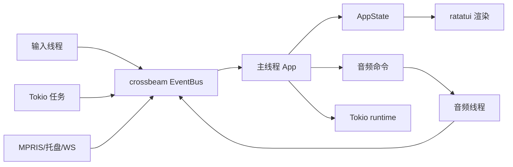
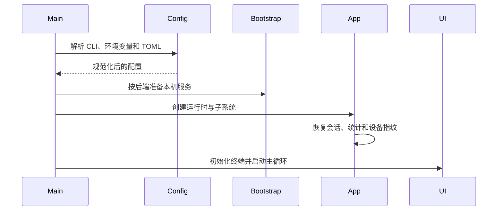
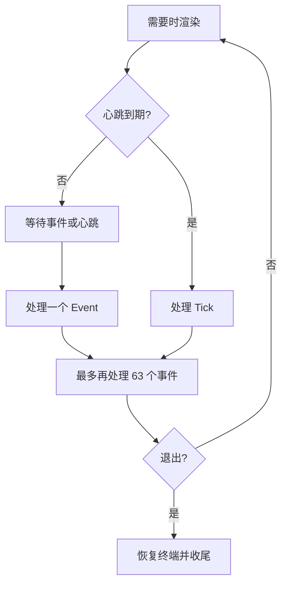
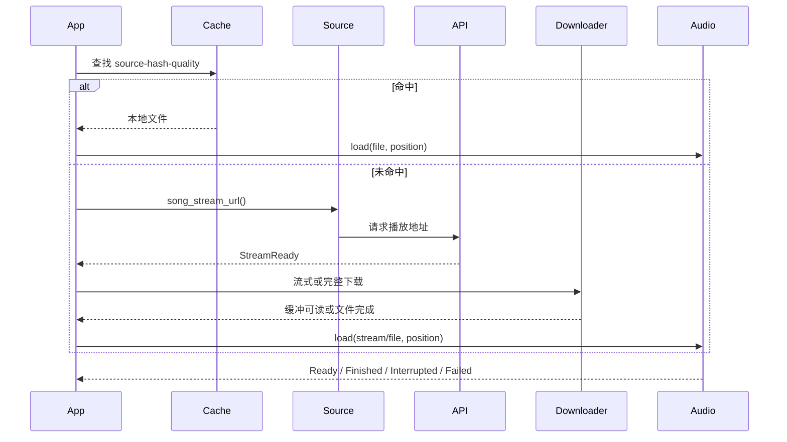

# 架构与实现

## 范围

本文对应 kugou-tui `0.8.2`。
内容以当前 `src/`、`Cargo.toml` 和 CI 配置为准。

kugou-tui 是 Rust 2024 edition 项目，MSRV 为 1.90。
主程序负责终端界面、状态管理、音源调用、缓存和音频播放。

默认 `--api native`，酷狗接口在进程内运行。
默认 feature 仍包含 Node 服务引导，供 `--api node` 回退使用。

## 目标与非目标

目标是提供低资源占用的终端播放器。
播放、搜索和界面刷新不共享同一阻塞线程。

目标是让不同音源共享一套业务层。
队列、歌词、封面和播放控制由领域模型统一表示。

非目标是把所有音源做成同一协议。
搜索、登录、会员和歌单能力仍由各音源单独实现。

非目标是让流式播放处理所有音频格式。
汽水的加密 MP4/CENC 产物必须先完整下载并解密。

非目标是引入动态插件系统。
新增音源需要修改编译期枚举和分派代码。

## 进程与线程



主线程持有唯一的 `AppState` 写权限。
输入线程、网络任务和音频线程只能通过 `EventBus` 提交事件。

事件总线使用 `crossbeam_channel::unbounded`。
主循环每次最多消费 64 个事件，避免事件洪水阻塞渲染。

Tokio runtime 使用两个 worker。
同步文件扫描和 libresoda 调用会进入 `spawn_blocking`。

音频线程名为 `kugou-audio`。
音频设备、rodio `Player` 和解码器都固定在这个线程。

## 启动流程



配置优先级为命令行、环境变量、配置文件和默认值。
启动时先用 `sources.active` 对齐顶层身份字段，再合并 CLI 覆盖值。

`App::new` 创建 API 客户端、音频句柄、缓存、下载器、MPRIS、托盘和 WebSocket。
随后恢复会话、读取听歌统计，并启动设备指纹和用户资料等后台请求。

配置文件损坏时回退默认值。
地址、音量、音质、刷新间隔和分页大小会在加载后规范化。

Node 服务只由酷狗后端引导。
服务已存在时复用；首次安装使用固定上游提交。

`native` 模式跳过 Node 服务探测。
网易云和汽水音乐也不由 `bootstrap.rs` 托管本机服务。

## 主循环



主循环先渲染脏帧，再等待事件或下一拍心跳。
非 `Tick` 事件会立即置脏。

静止页面不会按心跳重复绘制。
只有播放、忙碌状态或歌词过渡需要持续重绘。

普通间隔默认 200 ms。
播放时提升到约 33 ms；`lite_mode` 保持至少 200 ms。

`Tick` 使用实际时间推进。
鼠标移动产生的高频事件不能饿死歌词、频谱和进度更新。

## 状态模型

`AppState` 是纯数据结构。
它保存页面、焦点、列表游标、播放队列、当前曲目、歌词、封面和状态消息。

导航状态使用 `ratatui::widgets::ListState`。
滚动偏移和选中项因此可以跨帧保留。

`PlayQueue` 是当前播放上下文的唯一来源。
从列表播放会替换队列；追加和插播只修改队列内容。

`Song` 是统一歌曲模型。
`hash` 表示当前音源内取链和取歌词的主键。

`Song.source` 记录歌曲来源。
跨音源队列播放必须使用这个字段，而不是当前选中的音源。

异步结果携带请求身份。
搜索比较关键词，歌单比较当前打开项，播放结果比较歌曲 hash。

过期结果会被丢弃。
旧请求不能覆盖新搜索、新歌单或当前曲目。

## API 层

`MusicApi` 定义 TUI 实际需要的 26 个操作。
范围包括目录、播放直链、歌词、登录、会员和云端歌单写操作。

`ApiClient` 使用枚举分派 `Node` 与 `Native`。
这里不使用 trait object，因为异步 trait 与克隆、并发任务的使用方式不匹配。

`native` 只覆盖酷狗和酷狗概念版。
其它音源通过各自模块访问服务或公网接口。

`ApiClient` 仍为所有音源提供统一的 cookie 和后端构造入口。
网易云与汽水的请求语义位于 `src/source/`。

### Node 后端

Node 后端访问本机 KuGouMusicApi。
HTTP 客户端复用连接池，连接超时为 8 秒，请求超时为 15 秒。

读请求在瞬时故障时最多尝试三次。
重试间隔为 300 ms 和 900 ms。

写请求不自动重试。
写操作可能在响应丢失前已经成功，重发会改变结果。

响应先解析 JSON 和业务错误码。
只有响应体不可解析时才使用 HTTP 状态码判断错误。

需要绕过服务端两分钟缓存时，请求会增加时间戳。
写请求使用独立入口，避免继承读请求重试策略。

### Native 后端

Native 后端直接访问酷狗网关。
它自行生成设备标识、默认参数、请求签名和客户端请求头。

标准版与概念版使用不同的盐值、`appid` 和 `clientver`。
JSON 对象的键序会参与签名，因此 `serde_json` 启用了 `preserve_order`。

歌词下载支持 KRC 解密。
翻译与逐字时间解析后统一转换为领域模型。

Native 响应缓存有效期为 120 秒。
缓存最多保留 64 项，写请求不会使用可复用的缓存结果。

签名、设备指纹和 KRC 解密使用固定输入测试。
这些测试用于发现与上游实现的逐字节偏差。

## 音源分派

`SourceKind` 有四个值：

- `Kugou`
- `KugouConcept`
- `Netease`
- `Sodam`

每个值声明自己的搜索、登录、目录、云端和会员能力。
界面依据能力隐藏或禁用不适用的入口。

音源分派负责给搜索结果写入 `Song.source`。
这样可以避免数字 id 或 hash 在不同平台之间碰撞。

`SourceSet` 保存每个音源独立的地址、cookie、设备标识、启停状态和优先级。
切换音源会更新运行时顶层的地址和身份字段。

切换会重建 API 客户端。
已经装载的音频保持播放，不需要停止。

酷狗标准版与概念版使用不同登录体系。
两个平台的 cookie 和 `dfid` 不能复用。

网易云的登录 cookie 由服务端返回，客户端规范化后保存。
汽水的登录态保存在独立音源档案中。

## 播放链路



缓存键由音源、歌曲 hash 和音质组成。
试听片段使用独立 `-trial` 键，避免覆盖完整版缓存。

首次播放通常采用边下边播。
下载器先攒 128 KiB，再允许解码器开始读取。

续播位置大于 0 时先完整下载。
流式缓冲只有开头附近的数据，直接跳到中间会阻塞或超时。

汽水的解密结果使用 `file://` 地址。
该文件会复制进普通音频缓存，之后沿用同一套回收逻辑。

## 下载与缓存

流式缓冲只保留 4 MiB 内存窗口。
超过阈值后会回收到约 1 MiB，其余数据从 `.part` 文件按偏移读回。

读取等待单次超时为 15 秒。
下载失败、取消和暂时无数据由缓冲记录为不同状态。

完整下载会先发送 HEAD。
文件不小于 512 KiB 且支持 Range 时，最多并发四块。

每个 Range 响应必须是 `206`。
`Content-Range` 必须与请求范围和服务端总长度一致。

并发失败时回退单连接。
无论哪条路径，只有完整写入后才把 `.part` 改成正式缓存文件。

缓存达到上限后按修改时间删除旧文件。
回收目标是上限的 80%，单轮最多删除 512 个文件。

缓存扫描和清空都会跳过 `.part`。
正在下载或由崩溃留下的半成品不会参与容量回收。

完整下载落盘后会预取下一首。
预取失败不会改变当前播放状态。

## 音频引擎

主线程向音频线程发送同步命令：

- 装载音源
- 播放或暂停
- 停止
- 绝对或相对 seek
- 设置音量
- 切换输出设备

播放状态、位置、时长和音量使用原子量共享。
只有离散状态变化通过事件总线发送。

音频链路依次执行：

1. 解码文件或流。
2. 多声道下混为立体声。
3. 必要时进行抗混叠重采样。
4. 采集电平采样。
5. 交给 rodio 输出。

解码器无法向后 seek 时，引擎会重建解码器。
新解码器从数据源开头向前定位到目标位置。

播放器变空时不能直接判定播放结束。
引擎会区分取消、下载失败、流中断和完整结束。

流中断会保留播放位置。
第一次自动从断点重试，第二次交给用户按 `Space` 重试。

源级失败包括连接失败、登录失效和本机服务不可用。
程序最多自动尝试后续 `min(队列长度, 5)` 首，并跳过已确认失败的音源。

单曲级失败不会自动跳歌。
版权限制、VIP 权限和坏文件会停在当前曲目并显示原因。

## UI 与输入

界面使用固定骨架和自适应比例。
主区域包含侧边栏、内容区、播放器和状态栏。

终端窄于 56 列时隐藏侧边栏。
歌词在空间不足时从左右布局切换为上下布局。

按键先映射为语义 `Action`。
文本输入态优先保留字符输入，组合键仍可用于搜索类型切换等操作。

自定义键位在启动时装入全局表。
非法动作或按键只记录警告，不阻止程序启动。

鼠标交互依赖每帧重建的 `HitMap`。
视图登记矩形、目标类型、起始下标和行数。

事件层根据坐标和滚动偏移换算数据下标。
后登记的小区域优先命中。

进度条与音量条使用乐观更新。
音频 seek 按 200 ms 节流，松开时提交最终位置。

封面协议通过环境变量识别 Kitty 与 iTerm2。
tmux、screen 与未知终端回退到半块字符。

`lite_mode` 关闭封面和频谱，并把刷新限制到约 5 fps。

播放时显示迷你频谱。
可视化页显示 128 个频段，并保存最近 240 帧瀑布历史。

## 持久化与凭据

| 数据 | Linux 默认路径 |
|---|---|
| 配置 | `~/.config/kugou-tui/config.toml` |
| 缓存与日志 | `~/.cache/kugou-tui/` |
| 会话 | `~/.cache/kugou-tui/session.json` |
| 听歌统计 | `~/.cache/kugou-tui/stats.json` |

实际路径由平台目录 API 决定。
`KUGOU_TUI_CONFIG_DIR` 可覆盖配置根目录。

Unix 上配置目录权限为 `0700`。
配置文件和日志权限为 `0600`。

配置保存前会把当前音源凭据写回对应 `SourceProfile`。
临时 `--api-base` 不会覆盖音源持久化地址。

会话保存队列、游标、播放位置和当日 VIP 领取日期。
运行中每 30 秒保存一次，正常退出时再保存一次。

会话恢复不会自动播放。
只有用户主动播放且曲目 hash 匹配时，才恢复上次位置。

日志写入前统一脱敏敏感字段。
HTTP 错误会移除包含查询参数的 URL。

## 桌面集成

WebSocket 服务只监听 `127.0.0.1`，默认端口为 6520。
握手会校验本机 Origin，单条入站消息最大为 64 KiB。

服务端发送 `welcome`、`lyrics` 和 `playerState`。
客户端控制命令支持 `toggle`、`next` 和 `prev`。

MPRIS 与系统托盘只在 Unix 编译。
二者把控制请求转换成事件，由主线程执行。

MPRIS 暴露标准播放状态、元数据、相对 seek 和绝对定位。
托盘使用 StatusNotifierItem，可显示播放状态并提供菜单。

桌面集成失败不会阻止播放。
没有 D-Bus 或 StatusNotifierWatcher 时，对应句柄保持不可用。

## 关键不变量

- `Cava::execute` 返回内部缓冲借用，调用方必须立即复制。
- cava 输入采样必须保持倒序，`input[0]` 是最新样本。
- `plan_bands` 的 `first_bar` 必须跨迭代携带。
- `min_bandwidth` 必须使用整数除法。
- 图片协议检测必须先排除 tmux 和 screen。
- 所有动画缓动必须使用真实经过时间。

- `HitMap` 必须按当帧实际布局重新登记。
- `Song.source` 必须用于取链、歌词和缓存键。
- 流式任务切歌或停止时必须调用 `cancel()`。
- 写请求不得继承读请求的自动重试。

## 新增音源

新增音源需要修改：

1. `SourceKind` 枚举与能力声明。
2. `SourceSet` 配置字段。
3. 音源分派方法。
4. 搜索、取链、歌词、登录和目录实现。
5. 服务引导逻辑，仅当该音源需要本机服务时。

业务层只调用 `SourceKind` 方法。
不要直接在 UI 或播放控制中构造平台专用请求。

所有返回歌曲的路径都必须设置 `Song.source`。
跨音源队列依赖这个字段。

## 测试与构建

本地检查：

```bash
cargo fmt --check
cargo clippy --all-targets -- -D warnings
cargo test
```

CI 在 Linux、Windows 和 macOS 运行 clippy 与测试。
Linux 还覆盖 `--no-default-features`。

`cargo build --release --no-default-features` 移除 Node 引导代码。
此时 native 酷狗接口仍可构建，Node 后端不可用。

测试替身通过 `App::for_test` 创建。
它不访问真实网络、音频设备或用户配置目录。

布局测试使用 ratatui `TestBackend`。
`cargo test dump_a_frame -- --ignored --nocapture` 可输出整帧文本。

性能改动应参考项目记录的基线：

- 播放中 RSS 约 16 MiB。
- 可视化页 30 fps 时 RSS 约 16 MiB。
- release 二进制约 11.8 MiB。
- cava 与 libcava 1.0.0 的相对误差约 `1e-5`。

## 运行边界

Native 后端只实现酷狗标准版和概念版。
网易云需要独立运行的 NeteaseCloudMusicApi。

汽水音乐不支持流式首播。
加密流必须先完整下载、解密并落盘。

汽水扫码登录需要本机 Chrome、Chromium 或 Edge。
公共签名服务不可用时，VIP 整曲和无损可能无法获取。

封面协议探测不识别 sixel。
tmux 与 screen 一律使用半块字符。

WebSocket 只面向本机客户端。
当前控制面只有播放切换、上一首和下一首。
